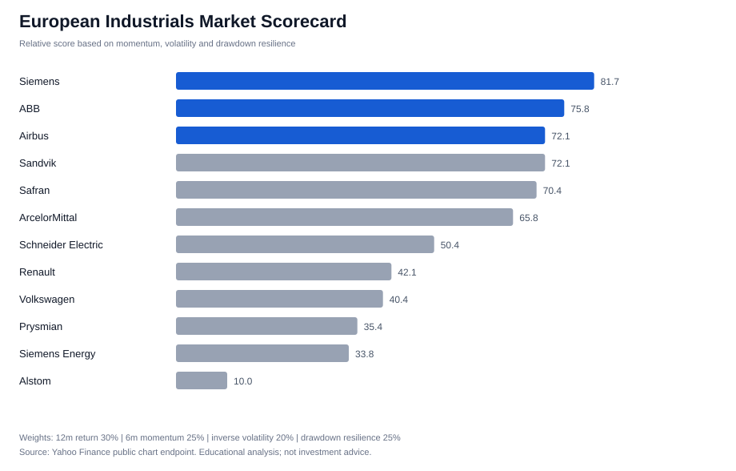
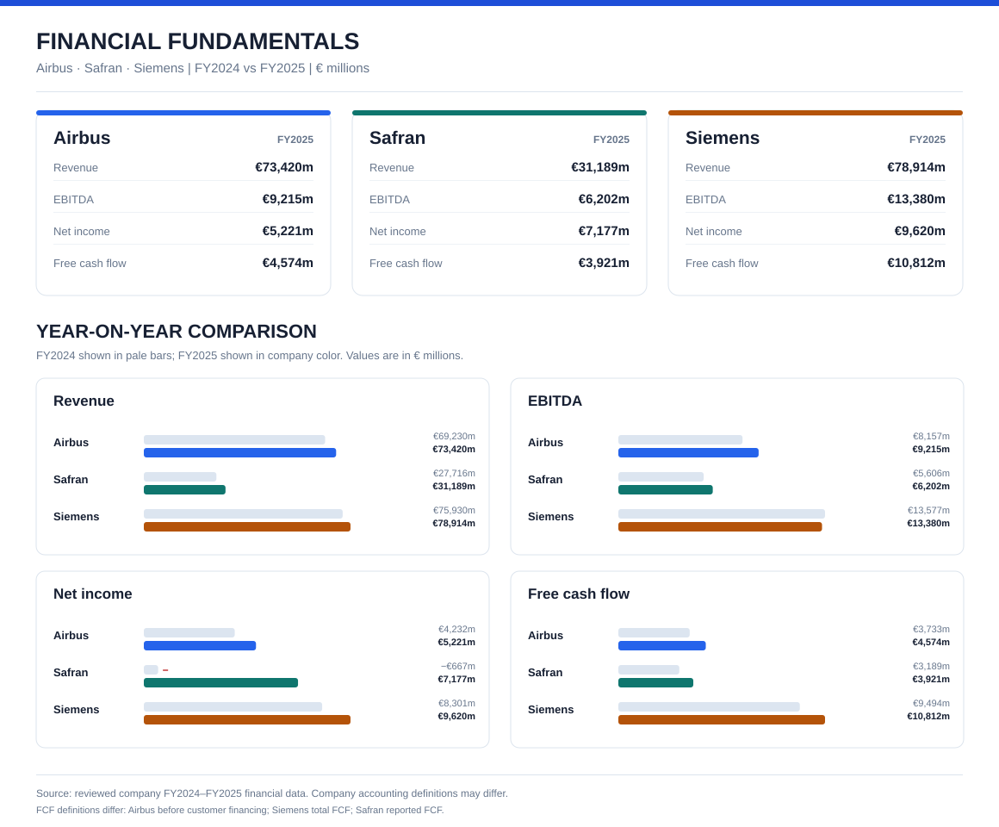
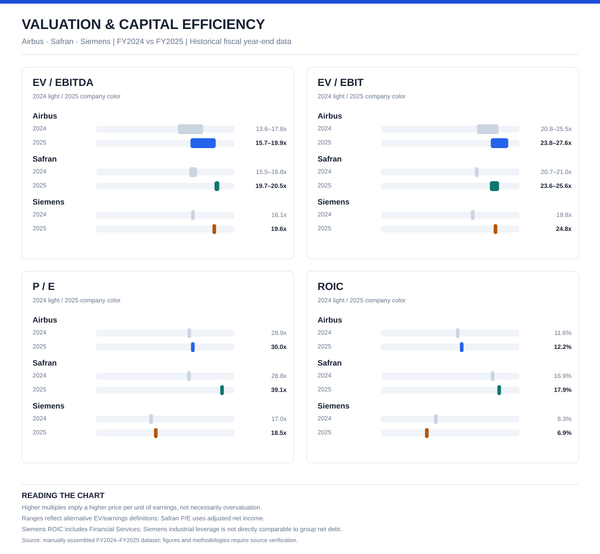

# European Industrials Market Monitor

An independent Python-based equity research project comparing European industrial companies through **market performance, financial fundamentals and earnings disclosures**. The aim is to make each result traceable to an underlying metric or source, rather than produce a black-box stock recommendation.

## What the project does

- **Market monitor:** downloads historical share prices, measures returns, momentum, volatility and drawdown, and ranks a 12-company European industrials universe.
- **Financial fundamentals:** compares FY2024 and FY2025 financial performance for Airbus, Safran and Siemens, including revenue, EBITDA, earnings, cash generation, profitability and selected valuation measures.
- **Interactive dashboard:** uses Streamlit and Plotly to explore company-level KPIs and comparisons.
- **Earnings intelligence:** extracts passages from company reports for review and future classification of operational themes.

## Company universe

The market monitor covers Airbus, Safran, Schneider Electric, Siemens, Siemens Energy, ABB, Alstom, ArcelorMittal, Renault, Volkswagen, Prysmian and Sandvik. **Detailed financial fundamentals currently cover Airbus, Safran and Siemens only.**

## Market scoring methodology

| Indicator | Weight | Direction |
|---|---:|---|
| 12-month return | 30% | Higher is better |
| 6-month momentum | 25% | Higher is better |
| Annualised volatility | 20% | Lower is better |
| Maximum drawdown | 25% | Less severe is better |

Each indicator is transformed into a cross-sectional percentile score, with risk indicators ranked inversely. The weighted composite score is a relative research tool, **not a forecast**.

## Market performance scorecard



The market scorecard is regenerated by the existing automated market-data workflow.

## Financial fundamentals | FY2024–FY2025



The financial graphic is generated directly from `data/financials_reviewed_2025.csv` by `generate_financial_readme.py`. It shows company KPI cards and year-on-year comparisons for revenue, EBITDA, net income and free cash flow. 

Reported financial measures are not always directly comparable: Airbus free cash flow before customer financing, Safran reported free cash flow, and Siemens total free cash flow use different definitions. The underlying dataset retains additional reported and adjusted metrics, and some manually supplied figures require further source verification. Valuation ratios refer to historical dates rather than live market prices.

## Valuation & M&A Analysis

Historical valuation multiples and capital-efficiency indicators
for Airbus, Safran and Siemens.



The analysis compares EV/EBITDA, EV/EBIT, P/E and ROIC
across FY2024 and FY2025.

Valuation multiples reflect historical fiscal year-end data.
Accounting definitions and valuation methodologies may differ
between companies.

## Run locally

```bash
python3 -m venv .venv
source .venv/bin/activate
python -m pip install -r requirements.txt
python src/analyze.py
python generate_financial_readme.py
streamlit run app.py
```

The market and financial SVG graphics are saved in `results/`.

## Automatic updates

- `.github/workflows/update-data.yml` refreshes market data and the market scorecard according to its configured schedule.
- `.github/workflows/financial-readme.yml` regenerates the financial README graphic when its input CSV or generator changes, and can be triggered manually.
- **Financial statement figures are reviewed and entered manually**; the workflow redraws charts but does not fetch or verify new annual reports.

## Key files

```text
app.py                              Streamlit entry point
pages/1_Financial_Fundamentals.py   Financial comparison dashboard
pages/2_Earnings_Intelligence.py    Report intelligence page
src/analyze.py                      Market indicators and scoring
data/companies.csv                  Market-monitor universe
data/financials_reviewed_2025.csv   Reviewed financial observations, FY2024–FY2025
generate_financial_readme.py        Financial SVG generator
results/market_scorecard.svg        Automatically generated market graphic
results/financial_dashboard.svg     Automatically generated financial graphic
.github/workflows/                 Automation workflows
```

## Next development priorities

1. **Expand fundamentals coverage** from three companies to the full 12-company universe, with source references and consistent fiscal-year treatment.
2. **Improve cross-company comparability**, separating IFRS and adjusted earnings, industrial versus consolidated debt, and differing free-cash-flow definitions.
3. **Standardize valuation dates and enterprise-value calculations** so historical multiples can be compared consistently.
4. **Extend the financial history** beyond two fiscal years and add multi-year trend analysis.
5. **Develop the earnings-intelligence module** into a cited, auditable classification of demand, pricing, supply-chain, capex and regulatory themes.
6. **Evaluate higher-quality data integrations**, including Bloomberg BQL if available.

## Disclaimer

Market data is sourced from Yahoo Finance's public chart endpoint and may be delayed or incomplete. Financial fundamentals are based on manually collected company disclosures and selected supplementary inputs. Definitions and reporting dates can differ. This project is for research and education, not investment advice.
